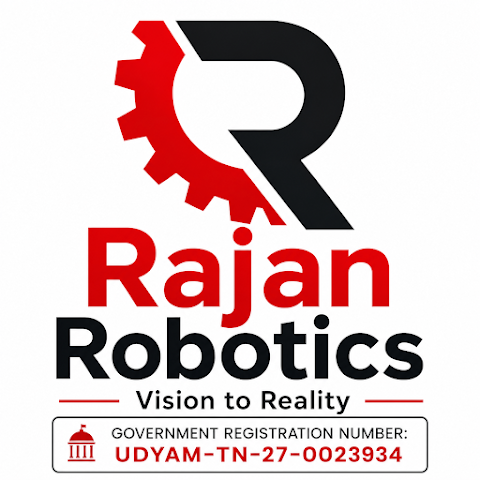

  

<h1 align="center">RAJAN ROBOTICS</h1>
<h3 align="center">Vision to Reality</h3>

  Government Recognised Robotics & Embedded Systems Training Company

Welcome to the official GitHub profile of **Rajan Robotics**!

We are passionate about teaching, motivating and empowering students to develop practical skills for the future through hands-on learning, electronics, robotics and embedded technology.

---

## 🚀 What We Teach

| Domain | Technologies |
|---|---|
| Robotics | Arduino, Sensors, Actuators |
| Embedded Systems | STM32, ESP32, Raspberry Pi |
| FPGA & VLSI | Verilog, FPGA Development |
| Internet of Things | ESP8266, MQTT, IoT |
| Programming | C, Python, MicroPython |
| Electronics | Fundamental & Practical Electronics |
| STEM Education | Hands-on STEM Projects |

---

## 🔧 Technologies We Work With

**Microcontrollers**
- Arduino UNO
- ESP8266 / ESP32
- STM32 Blue Pill
- Raspberry Pi Pico

**FPGA & Digital Design**
- Verilog HDL
- Shrike Lite FPGA
- Icarus Verilog
- GTKWave

**Development Tools**
- Arduino IDE
- STM32CubeIDE
- VS Code
- GitHub

---

## 💻 Our Projects

Explore our practical project repositories:

- [Arduino TM1637 Digital Clock](https://github.com/rajanrobotics05-RR/Arduino-TM1637-Digital-Clock)

More projects coming soon!

---

## 🎯 Our Mission

To make technology education practical, accessible and inspiring.

**Learn • Build • Experiment • Innovate**

---

## 🤝 Connect With Rajan Robotics

Follow us for practical electronics, robotics projects, workshops and technology learning resources.

**Rajan Robotics – Vision to Reality**

---

# 🚀 Featured Projects

### 🔴 1. Arduino Digital Clock using TM1637

A practical digital clock using Arduino UNO and a 4-digit 7-segment display.

**Technologies:** Arduino UNO | TM1637 | Embedded C++

[📂 View Source Code](https://github.com/rajanrobotics05-RR/Arduino-TM1637-Digital-Clock)

---

### 🔵 2. STM32 Projects

- GPIO Programming
- ADC and PWM
- Timers and Interrupts
- UART and I2C

*Coming soon*

---

### 🟢 3. ESP32 & IoT Projects

- ESP32 / ESP8266
- MQTT Communication
- Sensor Interfacing
- Wireless Monitoring

*Coming soon*

---

### 🟣 4. FPGA & VLSI Projects

- Shrike Lite FPGA
- Verilog HDL
- Digital Logic Design
- Counters and FSM

*Coming soon*

---

**Learn • Build • Experiment • Innovate**
